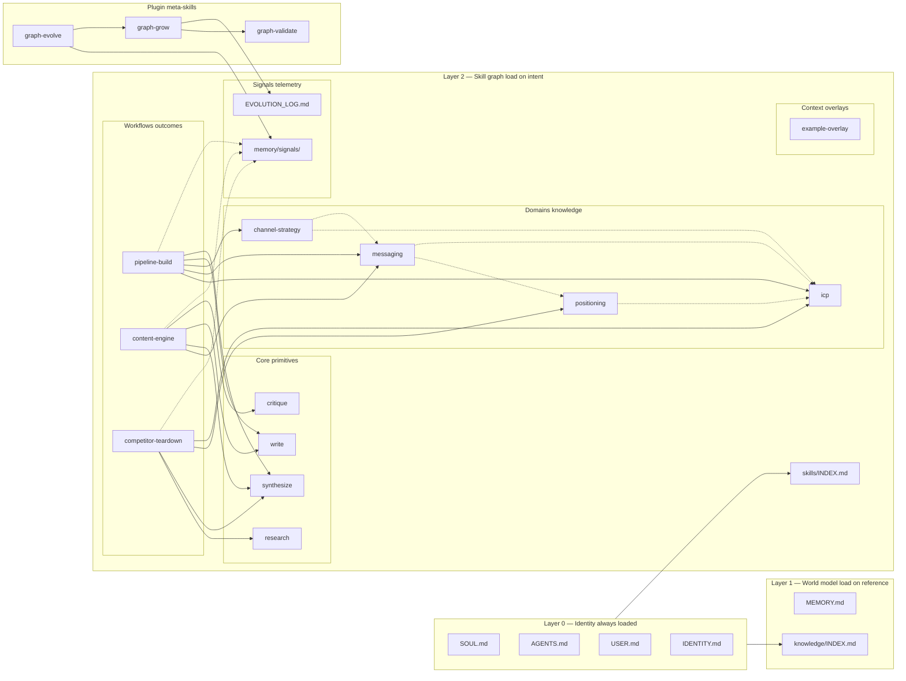

# Graph Diagram
**An example workspace a few weeks in, visualized. Use this as the mental model for what a healthy skill graph looks like.** The plugin ships the four core skills; the workflows and domains below are what a GTM user typically adds through `/graph-grow`.



---

## How to read this graph

- **Solid arrows** = workflow composition (the workflow loads the linked node when it runs).
- **Dotted arrows** = domain cross-references (knowledge nodes that relate, but neither is required to load the other).
- **Boxes inside Layer 2** = node types. Each type has its own loading rules.
- **Identity boxes (Layer 0)** = always loaded. The other layers are loaded only when a workflow or query requires them.

## What "good shape" looks like

1. Most arrows flow **workflow → domain** and **workflow → core**. Never **core → workflow** (cores are primitives) and rarely **domain → workflow** (domains are knowledge, not behavior).
2. Domains have **incoming arrows from multiple workflows**. If a domain has only one incoming arrow, it's not actually a domain — it's content that belongs inline in that one workflow.
3. **No arrow loops.** If you find a cycle, you have a structural error (a workflow depending on itself, or two workflows depending on each other).
4. **Meta-skills (graph-grow, graph-validate, graph-evolve) sit off to the side.** They live in the plugin and operate ON the graph, not IN it. No workspace workflow links to them. Their only edges are to each other and to the logs: graph-grow → graph-validate, graph-evolve → signals and graph-grow.

## What "going bad" looks like

| Symptom in the graph | What's actually wrong | Fix |
|---|---|---|
| A core node has an outgoing arrow | A core skill is calling other skills | SPLIT the core into a workflow + new core |
| A domain has zero incoming arrows | Knowledge that nobody uses | RETIRE or inline it |
| A domain has 6+ incoming arrows | The domain is too coarse | SPLIT into 2-3 finer domains |
| Two workflows share 5+ of the same dependencies | The two workflows are really one | MERGE |
| A context overlay has an `expires:` date in the past | Stale scope | DELETE |

## How to regenerate this graph for your own folder

Once you've migrated, ask your agent:

```
Read every workflow file in skills/workflows/.
For each one, list:
  - the workflow name
  - the wikilinks in its ## Composition section
Also read every domain file. For each, list its `linked_from:` value.
Then render a Mermaid flowchart in the same shape as the example in the
graph-concept skill's graph diagram. Save the result as GRAPH.md at the
workspace root (overwrite).
```

Run that monthly. The diff over time is the most honest picture of how your agent is actually evolving.
